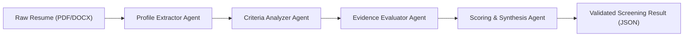

# Agentic AI-Based Recruitment and Resume Shortlisting System (FacultyHire)

An enterprise-grade, multi-agent AI-assisted recruitment platform designed for university faculty hiring. The system streamlines job postings, candidate registration, batch resume screening, and LLM-powered evaluation with strict criteria analysis, evidence extraction, and database persistence.

---

## 1. System Overview

FacultyHire combines a modern **React + Vite** frontend, a robust **Java Spring Boot** system of record, and a high-performance **Python FastAPI + LangGraph** multi-agent AI microservice.

### Key Capabilities
- **Job Management:** Create, view, update, and manage faculty job postings with pure numeric identifiers (`1`, `2`, `3`) mapped directly to database records.
- **Candidate Registry:** Register applicants, track recruitment status (`APPLIED`, `SHORTLISTED`, `REJECTED`, `INTERVIEW`), and view associated resumes.
- **Single Resume Screening:** Upload individual PDF or DOCX resumes against any job posting for instant AI-driven evaluation.
- **Batch ZIP Upload & Screening:** Upload a `.zip` archive containing multiple candidate resumes. The system automatically unzips, parses, queues, and enables one-by-one or automated batch screening across all candidates.
- **LangGraph Multi-Agent Architecture:** Utilizes a 4-agent state graph pipeline (Profile Extractor $\rightarrow$ Criteria Analyzer $\rightarrow$ Evidence Evaluator $\rightarrow$ Scoring Synthesis) with strict JSON schema validation and deterministic scoring.
- **1-Click Database Persistence:** Synchronize AI screening results and candidate records straight into PostgreSQL via the Java backend with a single click.
- **White-Labeled Enterprise UI:** Clean, modern interface without third-party vendor watermarks or external AI branding.

---

## 2. Technology Stack

| Layer | Technologies |
|---|---|
| **Frontend** | React 18, Vite, Lucide Icons, Modern CSS3 |
| **Main Backend** | Java 17+, Spring Boot 3.x, Spring Data JPA, Hibernate, Maven |
| **Database** | PostgreSQL |
| **AI Microservice** | Python 3.10+, FastAPI, Uvicorn, LangChain, LangGraph, Groq SDK, PyMuPDF, python-docx, Pydantic v2 |
| **Testing** | Pytest, Mocking, Spring Boot Test |

---

## 3. Project Structure

```text
AI_RecruitmentService/
├── start_all.bat                           # 1-Click launcher for Windows
├── start_all.sh                            # 1-Click launcher for Linux/macOS
├── pom.xml                                 # Java Spring Boot Maven configuration
├── mvnw / mvnw.cmd                         # Maven wrappers
├── src/                                    # Java Spring Boot application source
│   ├── main/java/com/recruitment/recruitment_system/
│   │   ├── candidate/                      # Candidate entity, repository, service, controller
│   │   ├── job/                            # Job entity, repository, service, controller
│   │   ├── resume/                         # Resume storage & metadata management
│   │   ├── screening/                      # Screening result persistence
│   │   └── RecruitmentSystemApplication.java
│   └── main/resources/
│       └── application.properties          # Spring Boot database & server settings
├── AI ATS frontend/recruitment-frontend/    # React + Vite frontend
│   ├── src/
│   │   ├── App.jsx                         # Main UI (Dashboard, Jobs, Candidates, AI Screening)
│   │   ├── App.css                         # Enterprise styling & responsive layout
│   │   └── main.jsx
│   ├── vite.config.js                      # Reverse proxies for /api (Java) & /api/v1 (Python)
│   └── package.json
└── ATS Final Project/backend/              # Python FastAPI AI Microservice
    ├── agents/
    │   ├── multi_agent_graph.py            # LangGraph 4-agent state machine
    │   └── screening_agent.py              # LLM client, structured outputs & fallbacks
    ├── routers/
    │   └── resumes.py                      # Single, batch ZIP, and direct text screening endpoints
    ├── schemas/
    │   └── resumes.py                      # Pydantic schemas (ScreeningResultResponse, etc.)
    ├── services/
    │   └── document_phaser.py              # PDF (PyMuPDF) and DOCX (python-docx) extraction
    ├── tests/                              # Pytest test suite (18 unit & integration tests)
    ├── main.py                             # FastAPI application entry point
    ├── requirements.txt                    # Python dependencies
    └── .env.example                        # Template for environment variables
```

---

## 4. Quick Start (One-Click Launcher)

### Windows
Double-click `start_all.bat` or run it from Command Prompt:

```cmd
start_all.bat
```

The script will:
1. Prompt for your PostgreSQL password (if not already set in `DB_PASSWORD`).
2. Launch the **Python AI Microservice** on `http://127.0.0.1:8001` in its own terminal.
3. Launch the **Java Spring Boot Backend** on `http://localhost:8080` in its own terminal.
4. Launch the **React Vite Frontend** on `http://localhost:5173` in its own terminal.
5. Automatically open `http://localhost:5173` in your default browser.

### Linux / macOS
```bash
chmod +x start_all.sh
./start_all.sh
```

---

## 5. Manual Setup & Execution

If you prefer running services individually or in development mode, follow these steps:

### Step 1: PostgreSQL Database Setup
1. Ensure PostgreSQL is installed and running.
2. Create a database named `recruitment_db`:
   ```sql
   CREATE DATABASE recruitment_db;
   ```
3. Set your PostgreSQL password environment variable:
   - **Windows (CMD):** `set DB_PASSWORD=your_password`
   - **Windows (PowerShell):** `$env:DB_PASSWORD="your_password"`
   - **Linux/macOS:** `export DB_PASSWORD=your_password`

### Step 2: Python AI Microservice (Port 8001)
1. Navigate to the Python backend directory:
   ```bash
   cd "ATS Final Project/backend"
   ```
2. Create and activate a virtual environment:
   ```bash
   python -m venv .venv
   # Windows:
   .\.venv\Scripts\activate
   # Linux/macOS:
   source .venv/bin/activate
   ```
3. Install dependencies:
   ```bash
   pip install -r requirements.txt
   ```
4. Configure `.env`:
   Create a `.env` file in `ATS Final Project/backend/`:
   ```dotenv
   GROQ_API_KEY=your_groq_api_key_here
   GROQ_MODEL=openai/gpt-oss-20b
   ```
   *(Supported models include `openai/gpt-oss-20b`, `llama-3.3-70b-versatile`, `mixtral-8x7b-32768`)*
5. Start the FastAPI server:
   ```bash
   python -m uvicorn main:app --host 127.0.0.1 --port 8001 --reload
   ```
   - Swagger Documentation: `http://127.0.0.1:8001/docs`
   - Health Check: `http://127.0.0.1:8001/health`

### Step 3: Java Spring Boot Backend (Port 8080)
1. From the project root (`AI_RecruitmentService/`):
   ```bash
   # Windows:
   mvnw.cmd spring-boot:run
   # Linux/macOS:
   ./mvnw spring-boot:run
   ```
2. The server initializes JPA schema and starts on `http://localhost:8080`.

### Step 4: React Frontend (Port 5173)
1. Navigate to the frontend directory:
   ```bash
   cd "AI ATS frontend/recruitment-frontend"
   ```
2. Install dependencies:
   ```bash
   npm install
   ```
3. Start the Vite development server:
   ```bash
   npm run dev
   ```
4. Access the web application at `http://localhost:5173`.

---

## 6. Multi-Agent AI Screening Architecture

FacultyHire replaces simple single-prompt completions with a specialized **LangGraph 4-Agent State Machine**:



1. **Profile Extractor Agent:** Extracts structured applicant information (name, contact, education, degrees, years of academic/industry experience, domain specializations).
2. **Criteria Analyzer Agent:** Compares candidate qualifications against the job description and required skills, classifying skills into `matched_skills` and `missing_skills`.
3. **Evidence Evaluator Agent:** Gathers direct citations, project references, and publication excerpts from the resume that validate claimed competencies.
4. **Scoring & Synthesis Agent:** Computes a calibrated match score ($0-100\%$), provides an executive hiring summary, and flags key strengths and risks.

### Robust Fallback System
The microservice enforces strict JSON schemas:
- Primary: Groq strict `json_schema` mode.
- Secondary Fallback: Standard `json_object` mode with Pydantic runtime validation.
- Tertiary Fallback: Zero-shot regex extraction to recover from malformed JSON responses without failing the request.

---

## 7. REST API Reference

### Python AI Microservice (Port 8001)

| Method | Endpoint | Description |
|---|---|---|
| `GET` | `/health` | Health check endpoint returning service and model status |
| `POST` | `/api/v1/screen-resume` | Screen a single resume (`multipart/form-data`: `file`, `job_id`, `job_title`, `job_description`, `required_skills`) |
| `POST` | `/api/v1/screen-resume/upload-zip` | Upload a `.zip` archive containing multiple resumes; unpacks and returns candidate list |
| `POST` | `/api/v1/screen-resume/screen-text` | Screen extracted text directly using numeric `job_id` |

### Java Spring Boot Backend (Port 8080)

| Method | Endpoint | Description |
|---|---|---|
| `POST` | `/api/jobs` | Create a new job posting |
| `GET` | `/api/jobs` | List all job postings |
| `GET` | `/api/jobs/{id}` | Get job details by numeric ID |
| `PUT` | `/api/jobs/{id}` | Update an existing job posting |
| `DELETE` | `/api/jobs/{id}` | Remove a job posting |
| `POST` | `/api/candidates/jobs/{jobId}` | Register a candidate under a specific numeric job ID |
| `GET` | `/api/candidates` | List all candidates across jobs |
| `GET` | `/api/candidates/{id}` | Get candidate details by ID |
| `POST` | `/api/candidates/{candidateId}/resume` | Store resume file and create resume metadata record |
| `GET` | `/api/resumes/{id}` | Retrieve resume metadata |
| `POST` | `/api/screening-results/resumes/{resumeId}` | Persist AI screening score, skills, and evidence |
| `GET` | `/api/screening-results` | List all saved screening results |
| `GET` | `/api/screening-results/resumes/{resumeId}` | Retrieve screening result for a given resume |

---

## 8. Verification & Automated Testing

The Python AI service includes comprehensive automated test coverage for health checks, document parsing, provider errors, and schema compatibility.

To run the automated tests:
```bash
cd "ATS Final Project/backend"
python -m pytest -v
```

### Test Suite Summary (18 Passed)
- `test_health.py` (3 tests): Service health, missing API key handling, and invalid model name handling.
- `test_document_phaser.py` (7 tests): PDF extraction, DOCX extraction, empty file rejection, invalid extension rejection, corrupt file error handling, Windows file-lock cleanup, and newline preservation.
- `test_screening.py` (8 tests): Single screening mocked pipeline, batch ZIP upload, direct text screening, rate-limit 429 handling, network timeout 504 handling, malformed JSON recovery, and Pydantic schema validation.

---

## 9. Security & Compliance

- **Credentials:** Never commit `.env` or database passwords. Keep `GROQ_API_KEY` and `DB_PASSWORD` in your local environment.
- **Data Privacy:** Resume documents contain personal identifiable information (PII). Ensure uploaded files and database backups are stored securely with restricted access.
- **Human-in-the-Loop:** AI screening results provide advisory ranking and matching metrics. Final hiring decisions rest with authorized department chairs and recruitment committees.
